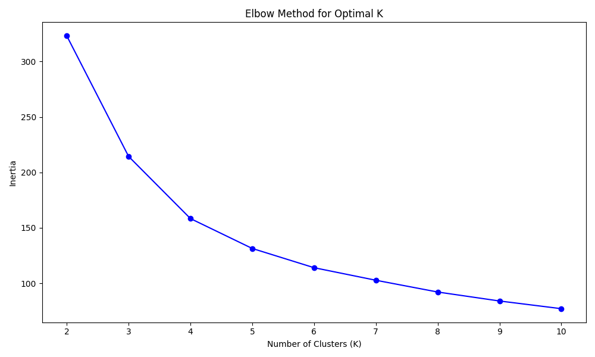
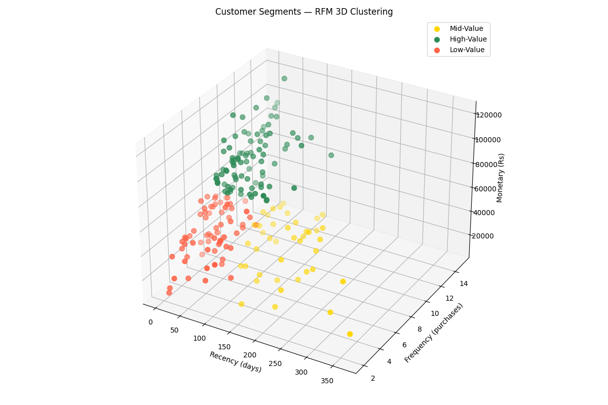
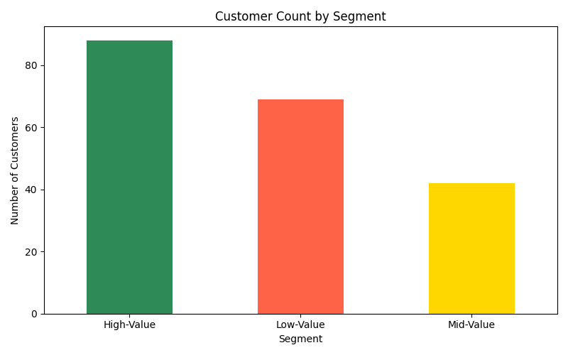

<div align="center">


</div>

---

## Overview

This is the **Month 1 Final Project** of the **CloudExify Data Science Summer Internship 2026**. It applies **RFM analysis** (Recency, Frequency, Monetary) and **K-Means clustering** — an unsupervised machine learning technique — to segment customers into behaviorally distinct groups based on their transaction history.

|---|---|
|---|---|
| **Difficulty** | Intermediate |
| **Language** | Python (Jupyter Notebook) |
| **Key Libraries** | pandas, NumPy, matplotlib, scikit-learn |
| **Time Invested** | 10–12 hours |
| **Submission** | End of Month 1 — Final |

---

## Repository Structure

```
cloudexify-ds-final-yourname/
├── charts/                                                    # Output visuals from both notebooks
├── sales_analysis.ipynb                                       # Project 1 — Sales Data Analysis
├── customer_segmentation.ipynb                                # Project 2 — Customer Segmentation (this project)
├── sample_data.csv                                            # Dataset for Project 1
├── customer_transactions.csv                                  # Dataset for Project 2
├── sales_analysis_evaluation_report.pdf                       # Project 1 summary report
├── customer_segmentation_evaluation_report.pdf                # Project 2 summary report
└── README.md
```

---

## What This Project Covers

- **RFM Analysis** — computing Recency, Frequency, and Monetary scores per customer
- **Feature Scaling** — standardizing RFM values with `StandardScaler` for distance-based clustering
- **Optimal K Selection** — elbow method across K = 2 to 10 to determine cluster count
- **K-Means Clustering** — segmenting customers into 3 groups (High-Value, Mid-Value, Low-Value)
- **Segment Profiling** — mean RFM values and customer counts per segment
- **3D Visualization** — scatter plot confirming visual separation between clusters
- **Business Recommendations** — targeted strategy per customer segment

---

## Segment Summary

| Segment | Customers | Avg Recency (days) | Avg Frequency | Avg Monetary (Rs) |
|---|---|---|---|---|
| High-Value | 88 | 42.39 | 9.98 | 76,564.78 |
| Mid-Value | 42 | 184.83 | 5.79 | 44,631.48 |
| Low-Value | 69 | 38.42 | 5.49 | 40,396.06 |

**Key insight:** Mid-Value and Low-Value customers spend and purchase at similar levels — what separates them is **Recency**. Mid-Value customers haven't purchased in ~185 days on average (lapsed), while Low-Value customers are recently active but low-spending (newer/low-engagement).

---

## Sample Outputs

<div align="center">

| Elbow Method | 3D Cluster Plot |
|---|---|
|  |  |

| Segment Distribution |
|---|
|  |

</div>

---

## How to Run

```bash
# 1. Clone the repo
git clone https://github.com/yourname/cloudexify-ds-final-yourname.git

# 2. Install dependencies
pip install jupyter pandas numpy matplotlib scikit-learn

# 3. Launch the notebooks
jupyter notebook customer_segmentation.ipynb
```

Run all cells top to bottom — the elbow plot, 3D scatter, and segment distribution charts each for demonstration, and the finally check `segmentation_report.txt`.

---

## Business Recommendations

| Segment | Recommended Action |
|---|---|
| High-Value | VIP treatment — exclusive offers, priority service |
| Mid-Value | Growth potential — targeted campaigns, loyalty programs |
| Low-Value | Win-back campaigns — special discounts, re-engagement offers |

---

## Testing Checklist

| Test Case | Status |
|---|---|
| Transaction data loaded | ✅ |
| RFM scores calculated | ✅ |
| Data normalized (StandardScaler) | ✅ |
| Elbow method (K = 2 to 10) plotted | ✅ |
| K-Means (K = 3) clusters assigned | ✅ |
| Segment profiles generated | ✅ |
| 3D visualization — clusters visible | ✅ |
| Final report generated | ✅ |

---

<div align="center">

**CloudExify Summer Internship 2026** · Data Science Track · Month 1 Final Project


</div>